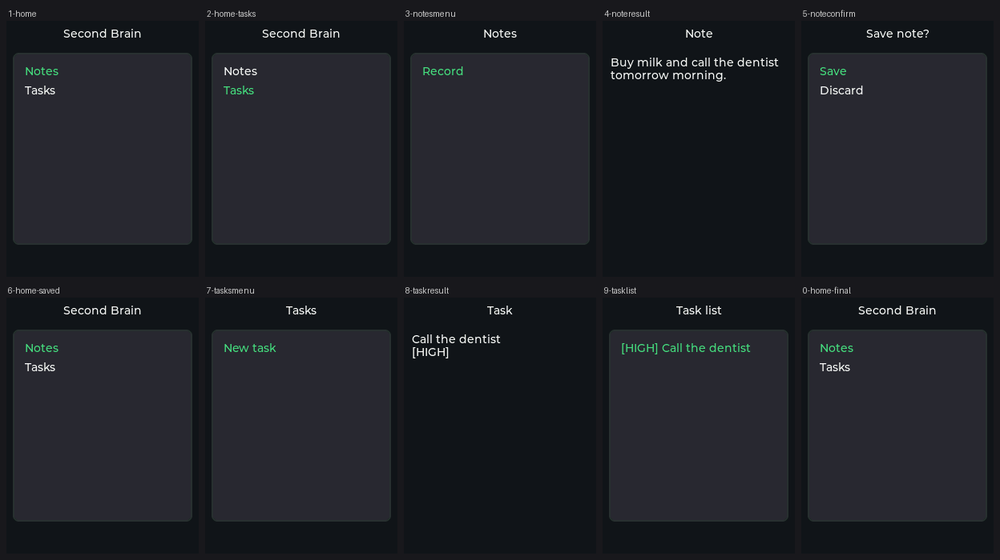
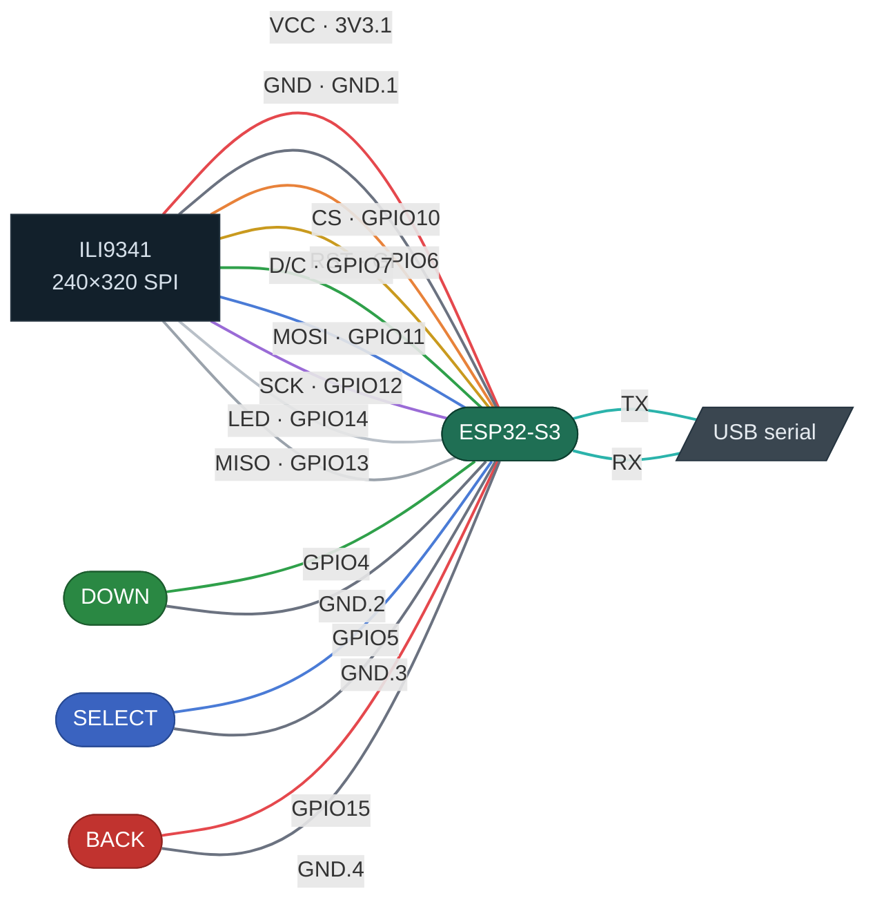
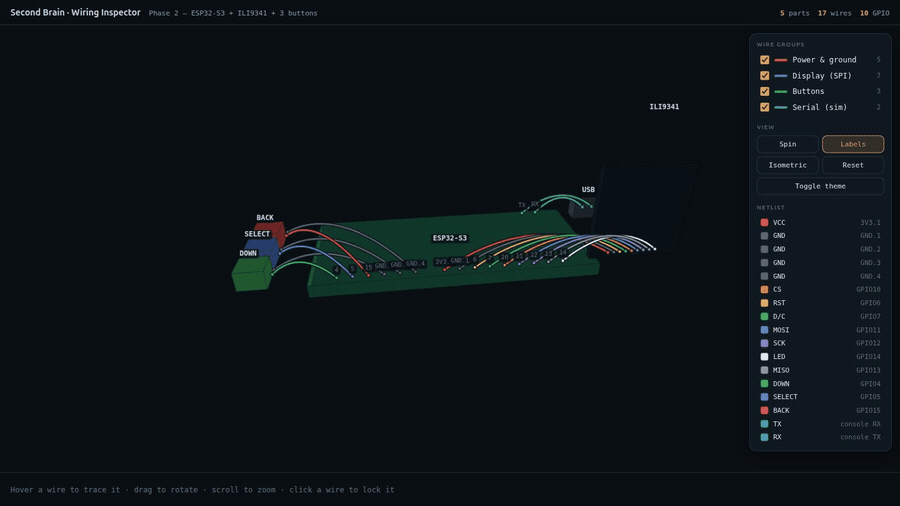

<div align="center">

<pre>
███████╗███████╗ ██████╗ ██████╗ ███╗   ██╗██████╗ 
██╔════╝██╔════╝██╔════╝██╔═══██╗████╗  ██║██╔══██╗
███████╗█████╗  ██║     ██║   ██║██╔██╗ ██║██║  ██║
╚════██║██╔══╝  ██║     ██║   ██║██║╚██╗██║██║  ██║
███████║███████╗╚██████╗╚██████╔╝██║ ╚████║██████╔╝
╚══════╝╚══════╝ ╚═════╝ ╚═════╝ ╚═╝  ╚═══╝╚═════╝ 
██████╗ ██████╗  █████╗ ██╗███╗   ██╗
██╔══██╗██╔══██╗██╔══██╗██║████╗  ██║
██████╔╝██████╔╝███████║██║██╔██╗ ██║
██╔══██╗██╔══██╗██╔══██║██║██║╚██╗██║
██████╔╝██║  ██║██║  ██║██║██║ ╚████║
╚═════╝ ╚═╝  ╚═╝╚═╝  ╚═╝╚═╝╚═╝  ╚═══╝
</pre>

**🧠 A voice-driven wearable second brain. Press a button, speak — get back a cleaned-up note or a prioritized task. Transcription and AI run entirely on your own laptop. No cloud, no subscriptions, no API keys.**

<p align="center">
  <a href="#license"></a>
  <a href="#what-it-is"></a>
  <a href="#status"></a>
  <br />
  <a href="#tech-stack"></a>
  <a href="#tech-stack"></a>
  <a href="#tech-stack"></a>
  <a href="#tech-stack"></a>
  <a href="#tech-stack"></a>
  <a href="#tech-stack"></a>
  <a href="#architecture-protocol-first"></a>
  <a href="#3-run-the-device-ui-simulated"></a>
</p>

</div>

> 🚧 **Work in progress — early development.** Personal project under active construction.
> Phases 1 and 2 run today; later phases (device↔brain networking, real hardware) are still
> ahead. Structure and details will change.

A voice-driven wearable "second brain." Press a button, speak, and get back a cleaned-up
**note** or a parsed **task with a priority** — all processed locally, free, no cloud.

## What it is

A tiny wearable device records a short voice clip. The clip syncs over Wi-Fi to a local
"brain" running on your laptop, which transcribes the speech and turns it into a note or a
task. Results show on the device screen and in a web dashboard. Everything runs on your own
machine — no subscriptions, no cloud, no API keys.

**Design model:** *store-and-forward* — the device records to an SD card and uploads to the
brain whenever Wi-Fi is available.

## Status

| Phase | What | State |
|---|---|---|
| **1** | Laptop brain (Python) + React dashboard | ✅ **Complete** — works end to end |
| **2** | Simulated device UI in Wokwi (LVGL, 3 buttons) | ✅ **Complete** — verified running in the simulator |
| **3** | Simulated device ↔ brain round-trip over Wi-Fi | ⏳ Next |
| **4** | Real microphone + SD card | 🔒 Needs hardware |
| **5** | Battery, enclosure, packaging | 🔒 Needs hardware |

Phases 1–3 cost nothing and validate most of the project before any parts are bought.

Full design: [`docs/superpowers/specs/2026-07-21-second-brain-design.md`](docs/superpowers/specs/2026-07-21-second-brain-design.md).
Hardware BOM and open questions: [`HARDWARE_BRIEF.md`](HARDWARE_BRIEF.md).

### The device UI, running in the simulator



Every screen above was captured from a real Wokwi run driven by the actual buttons, not
mocked up. Reproduce it: [Run the device UI](#3-run-the-device-ui-simulated).

### The wiring

Every connection in the Phase-2 setup, colour-coded to match the actual wires in
[`firmware/diagram.json`](firmware/diagram.json):



Full pin map, net list, power and gotchas: [`firmware/WIRING.md`](firmware/WIRING.md).

Want to rotate it in 3D and hover each wire? The clip below is a preview — **click it** to open
the live inspector:

[](https://akashvarma007.github.io/second-brain/wiring-3d.html)

**[Open the interactive wiring inspector →](https://akashvarma007.github.io/second-brain/wiring-3d.html)**
— drag to rotate, scroll to zoom, hover any wire to trace it, click to lock it. It's a single
self-contained file ([`docs/wiring-3d.html`](docs/wiring-3d.html)), so it also embeds anywhere
via `<iframe>`.

## Architecture (protocol-first)

Three parts, joined only by a language-neutral **HTTP + JSON protocol** — so any part can be
swapped without touching the others:

```
  DEVICE (C++)            PROTOCOL (HTTP+JSON)           BRAIN (Python)
  ESP32-S3          ◀───────── the stable seam ─────────▶ FastAPI
  screen, buttons,                                         faster-whisper (speech→text)
  record, display                                          Ollama llama3.2:3b (AI)
                                                           SQLite (notes, tasks)
                                                              ▲
                                          MONITORING UI (React + Vite + TS)
                                          lists notes/tasks, watches the pipeline
```

- **Device** and **brain** language are each swappable behind the protocol.
- Firmware is layered (portable `core/` + `hal/` + per-board `ports/`) so new hardware only
  needs a new port. All navigation logic lives in framework-free `core/` and is unit-tested
  on the laptop with no simulator at all.

## Repository layout

| Path | What | Status |
|------|------|--------|
| `brain/` | Python FastAPI server — Whisper + Ollama + SQLite | ✅ Phase 1 |
| `web/` | React + Vite + TypeScript monitoring dashboard | ✅ Phase 1 |
| `firmware/` | ESP32-S3 firmware (LVGL UI), runs in the Wokwi simulator | ✅ Phase 2 |
| `docs/` | Design spec + notes | ✅ |
| `HARDWARE_BRIEF.md` | Hardware BOM + open questions (for hardware review) | ✅ |

`brain/`, `web/` and `firmware/` each have their own README with the details.

---

# Getting started

Nothing here needs hardware. The whole thing runs on a laptop today.

## Prerequisites

| Need | For | Notes |
|---|---|---|
| Python 3.12 | `brain/` | |
| Node 22+ | `web/` | |
| [Ollama](https://ollama.com) | `brain/` | must be running locally |
| ~3 GB free disk | `brain/` | Whisper + `llama3.2:3b` models |
| [PlatformIO Core](https://docs.platformio.org/en/latest/core/installation/) | `firmware/` | only to build the device UI |

## 1. Run the brain (speech → note/task)

```bash
cd brain
python3 -m venv .venv
.venv/bin/pip install -r requirements.txt
ollama pull llama3.2:3b

.venv/bin/uvicorn app.main:app --reload --port 8000
```

Interactive API docs: <http://localhost:8000/docs>

Check the pipeline end to end (needs the server running, in another terminal):

```bash
cd brain && .venv/bin/python test_pipeline.py --mode task
```

**Endpoints:**

| Method + path | Body / query | Returns |
|---|---|---|
| `POST /process` | multipart `audio` + `mode=note\|task` | `{ transcript, result }` |
| `POST /process-sample` | `?mode=note\|task` | `{ transcript, result }` |
| `GET /notes` | — | `[ { id, text, created_at } ]` |
| `GET /tasks` | — | `[ { id, title, priority, created_at } ]` |
| `GET /health` | — | `{ status: "ok" }` |

## 2. Run the dashboard

```bash
cd web
npm install
npm run dev
```

Open <http://localhost:5173>. It lists notes and tasks and shows whether the brain is up.
It expects the brain on port 8000 — override with `VITE_API_BASE` in `web/.env.local`.

## 3. Run the device UI (simulated)

No ESP32 needed — the firmware runs in the [Wokwi](https://wokwi.com) simulator against a
virtual ILI9341 display and three virtual buttons.

```bash
cd firmware
pio run -e esp32-s3          # build the firmware
```

Then either:

- **VS Code:** install the Wokwi extension, open `firmware/`, start the simulation.
  `wokwi.toml` and `diagram.json` are already set up.
- **CLI (headless, scriptable):** see
  [`firmware/README.md`](firmware/README.md#automated-ui-regression-run). It drives all three
  buttons through every screen and saves a screenshot of each. Needs a free Wokwi CI token.

**Controls:** `DOWN` moves the cursor, `SELECT` enters/confirms, `BACK` goes up a level.

In Phase 2 the "transcribed text" is a hardcoded sample string. Phase 3 replaces it with a
real response from the brain.

## 4. Run the tests

```bash
# brain — fast unit tests, no models needed
cd brain && .venv/bin/python -m pytest -m "not slow"
# brain — real whisper + ollama (slow)
cd brain && .venv/bin/python -m pytest -m slow

# firmware — navigation/menu/input logic on the host, no simulator
cd firmware && pio test -e native

# firmware — compile check for the actual board
cd firmware && pio run -e esp32-s3
```

## Troubleshooting

**Brain returns 500 on `/process`** — Ollama isn't running, or `llama3.2:3b` isn't pulled.
Check with `ollama list`.

**First `/process` call is very slow** — Whisper downloads and loads `small.en` on first use.
Later calls are fast.

**Dashboard shows the brain as offline** — the brain isn't on port 8000, or CORS is blocking
it. `CORS_ORIGINS` defaults to the Vite dev ports (`localhost:5173`, `127.0.0.1:5173`);
`npm run preview` serves on 4173, so add it:
`CORS_ORIGINS=http://localhost:4173 .venv/bin/uvicorn app.main:app --port 8000`.

**Wokwi display blank / serial terminal empty** — run `wokwi-cli lint .` from `firmware/`
first. Wokwi *silently drops* any wire naming a pin the part doesn't have, so a diagram that
parses fine as JSON can still leave the display unpowered. On `board-esp32-s3-devkitc-1` the
rails are `3V3.1`, `3V3.2`, `5V`, `GND.1`..`GND.4` — there is no plain `3V3` or `GND`, and
every ground wire needs its own numbered pin. The serial monitor also stays blank unless
`esp:TX`/`esp:RX` are wired to `$serialMonitor`.

**Wokwi boot-loops** — `wokwi.toml` must point at the bare `firmware.bin`. Wokwi flashes it
at `0x10000` itself; a merged bootloader+app image does not work.

**Firmware panics in `tft.begin()` with `StoreProhibited` / `EXCVADDR: 0x00000000`** —
`-D USE_FSPI_PORT` is missing from `platformio.ini`. TFT_eSPI's ESP32-S3 fallback resolves
the SPI register base to address 0. See the comment on that flag for the full chain.

## Tech stack

- **Brain:** Python, FastAPI, [faster-whisper](https://github.com/SYSTRAN/faster-whisper) (`small.en`), [Ollama](https://ollama.com) (`llama3.2:3b`), SQLite
- **Dashboard:** React, Vite, TypeScript
- **Device:** ESP32-S3, Arduino framework, PlatformIO, LVGL 8.4, TFT_eSPI, tested in the [Wokwi](https://wokwi.com) simulator
- **Link:** HTTP over Wi-Fi (cloudflared tunnel to reach the laptop from the simulator)

## License

TBD (personal project).
